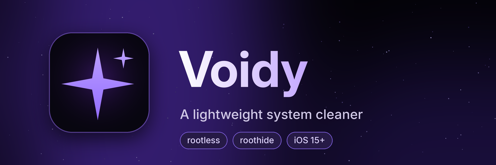
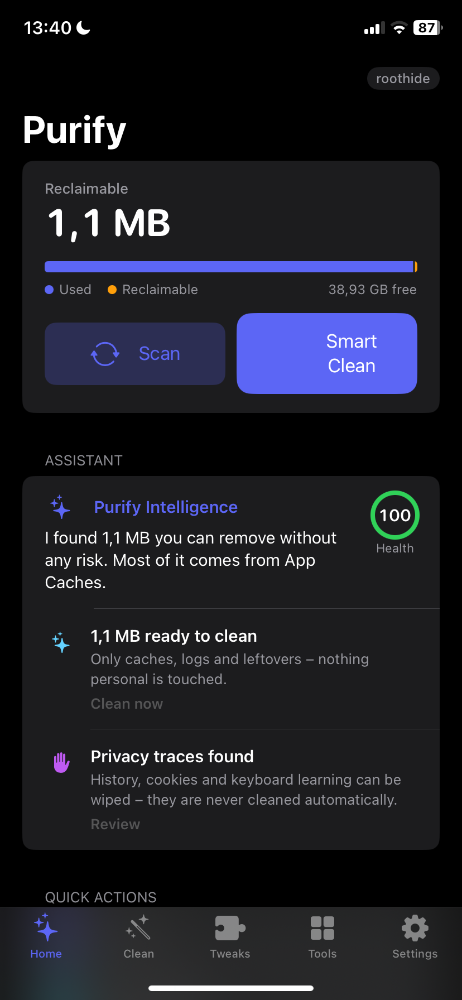
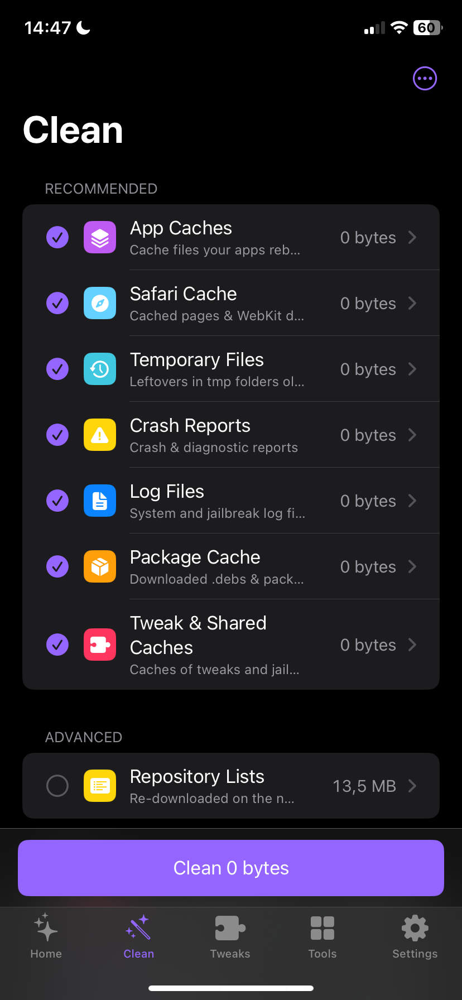
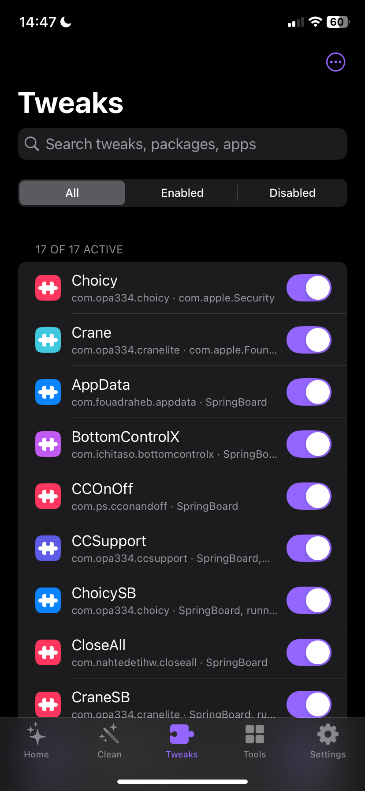
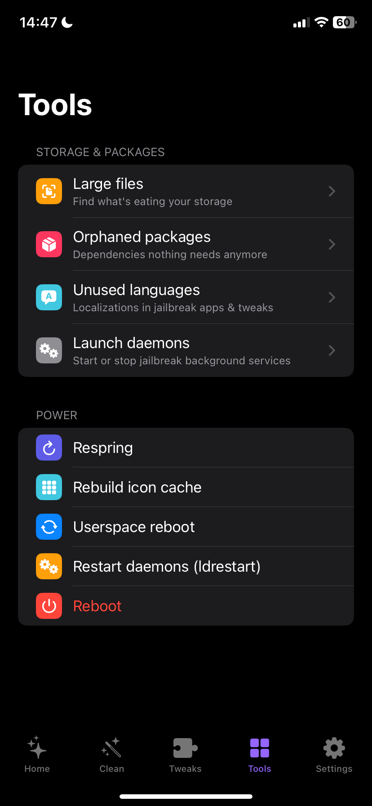
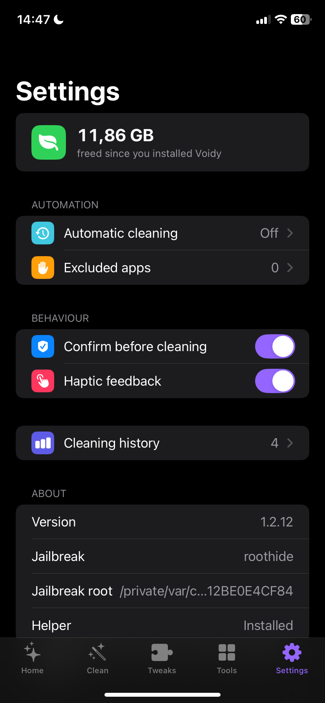

<p align="center"></p>

# Voidy

System cleaner for rootless and roothide jailbreaks. It removes caches, logs, temp files and package leftovers, lets you turn tweaks and launch daemons on and off, finds large files and orphaned packages, and can clean on a schedule.

Download it from [Releases](../../releases/latest).

## Screenshots

<p align="center">
  
  
  
  
  
</p>

<p align="center"><sub>Home · Clean · Tweaks · Tools · Settings</sub></p>

## Features

### Cleaning

| Category | Level | What gets removed |
|---|---|---|
| App caches | Recommended | `Library/Caches` of installed apps (individual apps can be excluded) |
| Safari cache | Recommended | Browser and WebKit caches |
| Temporary files | Recommended | tmp folders of the system, the jailbreak and apps (older files only) |
| Crash reports | Recommended | Crash and diagnostic reports |
| Log files | Recommended | System and jailbreak logs (folders are kept) |
| Package cache | Recommended | Downloaded `.deb` archives and package manager caches |
| Tweak caches | Recommended | Caches of tweaks and jailbreak apps |
| Repository lists | Advanced | Package lists, re-downloaded on the next refresh |
| Browsing history | Privacy | History and recently closed tabs |
| Cookies & website data | Privacy | Cookies and stored website data |
| Keyboard learning | Privacy | Learned word suggestions |

Privacy categories always need an extra confirmation and are never cleaned automatically.

Recommended cleaning removes regular files older than 24 hours, preserves directories and database files,
and skips running apps (including suspended apps and extensions) and files in use. Voidy no longer
force-quits Safari or package managers. A scan shows eligible file sizes; the final clean may free less
because app activity is checked again before deleting. Close an app and retry later if it was skipped.
Incomplete package downloads are kept. App exclusions also apply to Safari and package-manager caches,
and changes to exclusions immediately apply to an existing schedule.

### Insights
After every scan Voidy looks at the results (on the device, nothing is sent anywhere):
- Health score from 0 to 100
- Detects processes that crash repeatedly and points you to your tweaks
- Flags apps with very large caches (e.g. offline music) and offers to exclude them
- Warns when storage is almost full

### Tweaks
- Every installed tweak with its package and target apps
- Search and filter (all / enabled / disabled)
- Toggle tweaks on and off without deleting anything
- Disable all for troubleshooting, then Restore

### Tools
- Large files: find them, swipe to delete
- Orphaned packages: remove unused dependencies (`apt-get autoremove`)
- Unused languages: remove localizations from jailbreak apps and tweaks
- Launch daemons: start and stop jailbreak background services
- Power: respring, rebuild icon cache, userspace reboot, ldrestart, reboot

### More
- Automatic cleaning in the background, every 6 hours up to weekly
- History of all cleans with a chart
- Home screen quick actions: Smart Clean and Respring
- English, German and Simplified Chinese

## Requirements

- iOS 15 or later
- A rootless or roothide jailbreak with a package manager (Sileo, Zebra, ...)

Sideloading just the `.app` doesn't work, Voidy needs its root helper from the package.

## Installation

1. Download the matching file from the [release page](../../releases/latest):

   | File | Jailbreak |
   |---|---|
   | `voidy_<version>_rootless_iphoneos-arm64.deb` | rootless |
   | `voidy_<version>_roothide_iphoneos-arm64e.deb` | roothide |

2. Open the `.deb` with Sileo, Zebra or Filza and install it.
3. Launch Voidy from the home screen.

## Building

You need [Theos](https://theos.dev) with Swift support (easiest on macOS with Xcode). For roothide, use the
[roothide fork of Theos](https://github.com/roothide/theos).

```sh
# rootless
make package FINALPACKAGE=1 THEOS_PACKAGE_SCHEME=rootless

# roothide
make package FINALPACKAGE=1 THEOS_PACKAGE_SCHEME=roothide THEOS=/path/to/roothide-theos
```

Packages end up in `packages/`.

### Releases

Every push runs isolated cleaning/schedule regression tests and builds both variants on GitHub Actions.
Only the `Main` branch publishes release `v<version>` (version from `control`). Previous releases remain
available. Pull requests and other branches are tested and built without publishing.

Run helper regression tests on macOS with:

```sh
clang -fobjc-arc -fblocks -framework Foundation tests/helper_tests.m -o /tmp/voidy-helper-tests
/tmp/voidy-helper-tests
```

The process checks use Apple's private [libproc interfaces](https://github.com/apple-oss-distributions/xnu/blob/main/libsyscall/wrappers/libproc/libproc.h).
If process inspection fails, cleaning skips the affected work. iOS hardware validation remains necessary;
desktop tests cannot reproduce a jailbreak's process permissions or all app-specific cache behavior.

## Project layout

```
app/                 SwiftUI app
  Sources/           UI, data model, insight rules
  Resources/         Info.plist, icons, translations
voidyhelper/        Root helper (Objective-C), replies with JSON
layout/DEBIAN/       Install and uninstall scripts
control              Package metadata
CHANGELOG.md         Release history
```

The app has no root privileges itself. For every action it runs `voidyhelper` as root and reads its JSON reply.
The helper finds the jailbreak root from its own location, so the same code works on rootless (`/var/jb`) and roothide.

## Safety

- The helper only accepts calls from root or from the installed Voidy app.
- Files are only removed from clearly defined locations. Photos, messages, contacts, keychain, mail,
  preferences and the package database are protected.
- Core jailbreak services cannot be turned off in the daemon list.
- Tweaks are only disabled (their filter file is renamed), never deleted.

## Uninstalling

Removing the package turns every tweak and daemon Voidy disabled back on and removes the cleaning schedule.

## License

MIT, see [LICENSE](LICENSE).
